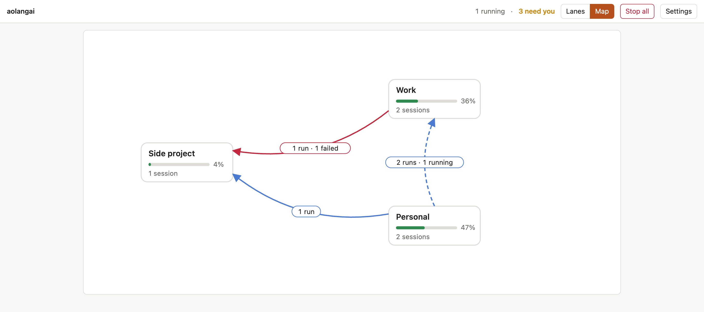

# aolangai

[](https://openyard.cloud/p/aolangai#check)

**See the quota of all your Claude accounts in one window, and hand work to the one with the most left.** A macOS app and a command for people with more than one Claude subscription account on one Mac.

[Website and demo](https://aolangai.openyard.cloud) · [Reference](docs/reference.md) · [Privacy](docs/reference.md#privacy) · Part of [OpenYard](https://openyard.cloud)


- **One window for every account.** Quota bars and the Claude Code sessions open on your Mac, in the app and in the menu bar.
- **Another account when one runs out.** **Open Terminal** starts Claude Code on the account you pick.
- **Delegate.** Tell Claude to "delegate this to a subagent", and the `aolangai` command runs the work on the account with the most quota left, so it stops draining the one you are using. If that account hits its limit mid-task, the task moves to the next account by itself.

aolangai is an independent open-source project. It is not affiliated with or endorsed by Anthropic.

## Read this first

- Splitting load across several Claude subscription accounts is a gray area under Anthropic's terms, and you carry the risk.
- There are second-hand reports (February 2026) that Anthropic does not allow subscription logins in third-party tools, and that people using several accounts were locked out. These reports are not verified first-hand.
- Read Anthropic's current Consumer Terms before you rely on this tool or share it.

aolangai never logs in for you, never reads or stores a login token, and the only `claude` it runs is the one you installed. It sends nothing anywhere itself: [what it reads on your Mac](docs/reference.md#privacy).

## Install

You need a Mac with Apple silicon, Claude Code (`claude`) logged in to at least one account, `git`, and Node 22.13 or newer (only to build).

```sh
git clone https://github.com/openyard-cloud/aolangai.git
cd aolangai
npm install
npm run dist
open apps/desktop/release/mac-arm64
```

Drag `aolangai.app` from the folder that opens into Applications, and open it. The app installs the `aolangai` command and the Claude Code skill by itself.

- macOS asks whether aolangai may control Terminal. Allow it: the buttons that open Terminal need it.
- There is no download yet: the app is signed only for the Mac that builds it.
- A `claude` installed with nvm, fnm, volta or asdf is found through your login shell's `PATH`. [Where the app looks, and how to update](docs/reference.md#install-and-setup).

## Set up

A card at the top of the window walks you through these steps.

1. **Add your accounts** in **Settings → Accounts → Add account**. For the account already logged in, choose **default (~/.claude)**. For any other, choose **let the app create its own folder (auto)**, press **Log in**, then **Check** until it says `connected`.
2. **Turn on Accepting work** on each account that should take delegated work. An account starts as **Watch only**: its quota shows, but no work goes to it. Your main account can stay that way.
3. Optional: **Edit** an account to limit it to certain folders, or to change its reserve, the used percentage at which it stops taking work (90 by default).

## Use

**Delegate from Claude Code.** In a session, say for example "Delegate this to a subagent: add tests for `parse()` in `src/foo.ts`". Claude calls `aolangai`, which sends the work to the account with the lowest used percentage among those accepting work. A session that was open before you installed needs a restart first.

You can also call the command yourself:

```sh
~/.local/bin/aolangai run "Add tests for parse() in src/foo.ts" --cwd ~/Projects/app --label "add tests"
~/.local/bin/aolangai status      # accounts and runs in progress
~/.local/bin/aolangai stop --all
```

**In the app.**

- Each run says `from <account> · <session>`: the Claude Code session that delegated it. Click a run to see its prompt, result and steps, **Asked by** with **Switch to**, and **Stop**, **Retry** and **Open in Terminal**.
- **Needs you** collects runs that failed, hit a limit or had a permission denied, and accounts over their reserve.
- **Switch to** brings an open session's Terminal tab or app to the front.
- **×** on a finished run, or **Clear finished** on a lane, hides it from the lane and from Needs you. It stays in the database, and the Map still counts it.
- **Map** (the `Lanes | Map` switch) draws which account's sessions delegated to which in the last 24 hours; click a box or an arrow to see the sessions and their runs.




## Status

- Version 0.1.0. macOS on Apple silicon only. The app and the command are in English.
- Delegating has been used for real from Claude Code in a terminal only. Calling the command from a Code session of Claude desktop has not been verified.
- Not confirmed by a person yet: the Terminal automation of the packaged app (**Log in**, **Open Terminal**, **Open in Terminal**, **Switch to**, session names). The tests cover the scripts it sends, but nobody has watched them work from the packaged app.
- A delegated run cannot ask for approval midway. A command that was not allowed beforehand is refused and recorded.
- Each account has its own `CLAUDE.md`, skills and permission rules. aolangai copies nothing from one account to another.
- Only Claude subscription accounts. No API keys, Cursor or Codex yet.

[Every known limitation](docs/reference.md#known-limitations).

## More

The [reference](docs/reference.md) has the rest: [the command](docs/reference.md#the-command) and its [exit codes](docs/reference.md#exit-codes), [how an account is chosen](docs/reference.md#how-an-account-is-chosen), [guards and tuning](docs/reference.md#guards-and-tuning-settings--limits), [privacy](docs/reference.md#privacy), [uninstalling](docs/reference.md#uninstall) and [development](docs/reference.md#development).

## Tiếng Việt

aolangai dành cho ai có nhiều account Claude thuê bao trên cùng một máy Mac: xem quota của mọi account và các session Claude Code đang mở trong một cửa sổ, và cho session Claude Code giao việc sang account còn nhiều quota nhất. Account nào hết quota giữa chừng thì việc tự chuyển sang account kế tiếp. Cách cài: chạy các lệnh ở mục Install (cần Node 22.13 trở lên), kéo `aolangai.app` vào Applications, mở app và làm theo thẻ thiết lập. Giao diện bằng tiếng Anh. Nhớ đọc mục "Read this first" trước khi dùng.

## License

[MIT](LICENSE)
