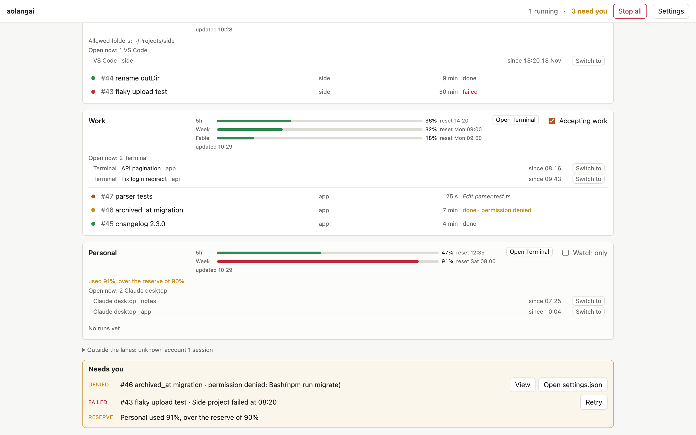
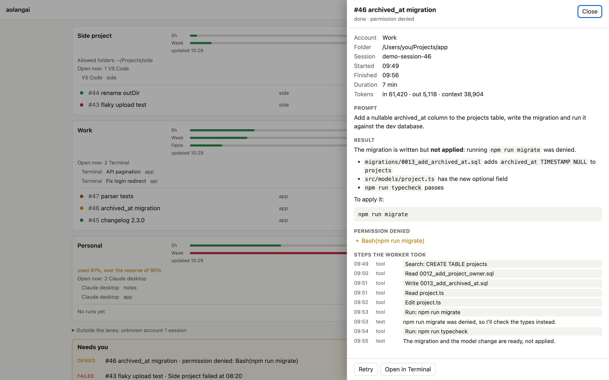
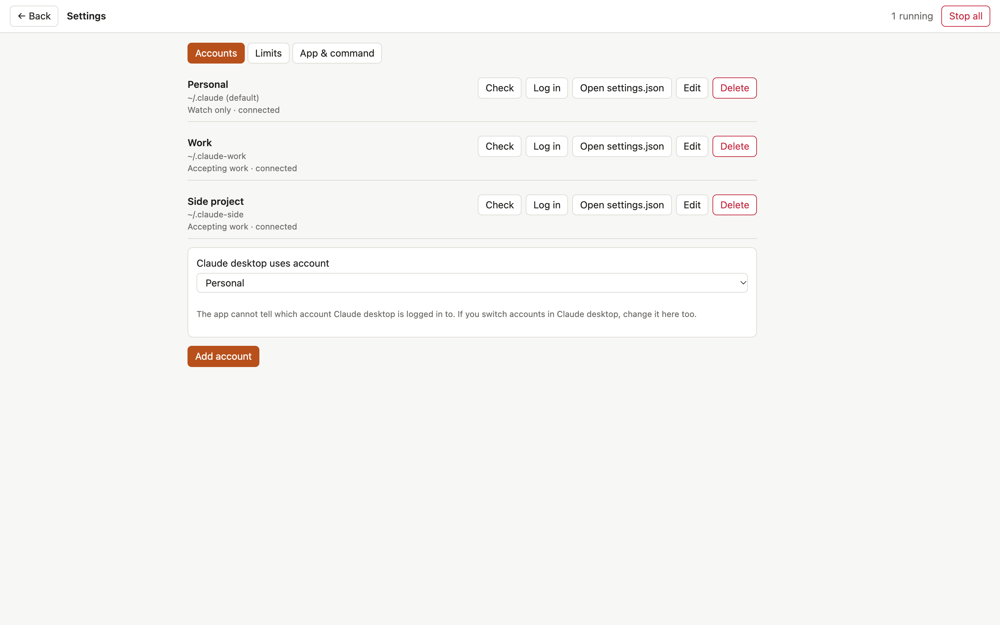

# aolangai

[](https://openyard.cloud/p/aolangai#check)

For people with more than one Claude subscription account on one Mac. A macOS app shows the quota of every account and the Claude Code sessions open on the machine, in one window and in the menu bar, and has an **Open Terminal** button that starts Claude Code on another account. The `aolangai` command lets a Claude Code session hand a piece of work to the account with the most quota left, so subagent work stops draining the account you are using.

[Website and demo](https://aolangai.openyard.cloud) · [Privacy policy](https://aolangai.openyard.cloud/privacy) · Part of [OpenYard](https://openyard.cloud)


aolangai is an independent open-source project. It is not affiliated with or endorsed by Anthropic.

## Status

- Version 0.1.0. macOS on Apple silicon only. The app and the command are in English.
- There is no download. The app is ad-hoc signed for the Mac that builds it, so you build it yourself from this repository (see [Install](#install)).
- The command is meant for Claude Code in a terminal and for Code sessions of Claude desktop, the places where a session has Bash on the Mac. It has been used for real from Claude Code in a terminal only. Calling it from a Code session of Claude desktop has not been verified.
- Not confirmed by a person yet: the Terminal automation of the packaged app (**Log in**, **Open Terminal**, **Open in Terminal**, **Switch to**, session names). The tests cover the scripts it sends, but nobody has watched them work from the packaged, ad-hoc signed app.

## Before you use more than one account

- Splitting load across several Claude subscription accounts is a gray area under Anthropic's terms, and you carry the risk.
- There are second-hand reports (February 2026) that Anthropic does not allow subscription logins in third-party tools, and that people using several accounts were locked out. These reports are not verified first-hand.
- The quota numbers come from an experimental call of the Claude Agent SDK, pointed at the `claude` you installed. That call may change or disappear in a later SDK version.
- Read Anthropic's current Consumer Terms before you rely on this tool or share it.

What aolangai does not do: it never logs in for you (logging in goes through Claude's own `claude auth login`), it never reads, stores or forwards a login token, and the only `claude` it runs is the one you installed yourself.

## Install

Requirements: macOS on Apple silicon; Claude Code (`claude`) installed with at least one Claude subscription account logged in; `git` (on a clean Mac: `xcode-select --install`); and, only to build, Node 22.13 or newer. The built app does not need Node. A `claude` installed under a Node version manager (nvm, fnm, volta, asdf) is not found by the app: see [where the app looks for `claude`](docs/reference.md#install-and-setup).

```sh
git clone https://github.com/openyard-cloud/aolangai.git
cd aolangai
npm install
npm run dist
```

`npm run dist` builds everything, packs `apps/desktop/release/mac-arm64/aolangai.app` and checks it. Drag it into Applications and open it; it installs the skill and the command `~/.local/bin/aolangai` each time it opens. A Claude Code session that was already open may need restarting to see the skill. Closing the window leaves it in the menu bar; **Quit** there stops it. Updating and the setup card: [more](docs/reference.md#install-and-setup).

The first time the app drives Terminal, macOS asks for permission to let aolangai control it, used for **Log in**, **Open Terminal**, **Open in Terminal**, **Switch to** and session names. If a Claude Code session is open in Terminal, the prompt can appear by itself within seconds of the first launch, before you press anything: the scan for session names asks Terminal for its tab titles. Because every ad-hoc signed build has a new signature, macOS may ask again after each rebuild. If you refused, the app says `Could not open Terminal. Check that aolangai may control Terminal in System Settings > Privacy & Security > Automation.` macOS may also ask to allow notifications the first time the app posts one, and may show a Login Items notice when you turn on **Open aolangai at login**; nobody has confirmed either on the packaged app yet.

## Set up

Four words used from here on: a **run** is one piece of delegated work; it runs as a **worker**, a `claude -p` process on the chosen account; the Claude Code session that delegates is the **main session**; each account has a **lane** in the app's window. A setup card at the top of the window walks through these steps.

1. **Settings → Accounts → Add account.** Each account is one Claude Code config dir. For the account already logged in at `~/.claude`, choose **default (~/.claude)**. For any other, choose **let the app create its own folder (auto)** or **another path** such as `~/.claude-b`, then press **Log in** (Terminal opens with `claude auth login` for that config dir) and **Check** until it says `connected`.
2. **Turn on Accepting work** on the lane of each account that should take runs. A new account starts as **Watch only**: its quota still shows, but no run goes to it. Your main account can stay that way.
3. **Edit** each account to set its allowed folders (one per line, subfolders included, empty means anywhere) and its reserve, the used percentage at which it stops taking new runs (default 90).
4. **Settings → App & command → Install skill and command** writes the skill into `~/.claude/skills/aolangai/` and each account's own config dir, and the command to `~/.local/bin/aolangai`. The packaged app also does it by itself. [Details](docs/reference.md#where-the-skill-and-the-command-go).

## The app

**Lanes** show each account's quota, its **Accepting work** / **Watch only** switch, its open sessions and its runs. **Needs you** collects runs that failed, hit a limit or had a permission denied, and accounts over their reserve. Failed and limited runs have **Retry**; a denied run has **View** and **Open settings.json**. Clicking a run shows its prompt, result and steps, with **Stop**, **Retry** and **Open in Terminal**, which resumes the worker's session so you can talk to it ([more](docs/reference.md#the-window)).





**Open Terminal** on a lane opens a Terminal window in a folder you pick, running `claude` on that account: use it when the account you work in runs out of quota. That session is yours, not a run, so it has no **Stop** and is not in the run history ([more](docs/reference.md#open-terminal)).

**Open sessions.** Every 10 seconds the app lists the Claude Code sessions open on the Mac on their account's lane, each with **Switch to** to bring its Terminal tab or app to the front. Claude desktop has its own login, so its sessions stay under `Outside the lanes` until you name its account in **Settings → Accounts** ([more](docs/reference.md#open-sessions)).

**Settings** has three tabs: **Accounts**, **Limits** ([guards and tuning](docs/reference.md#guards-and-tuning-settings--limits)) and **App & command** ([more](docs/reference.md#settings)).



**Menu bar and notifications.** The menu bar shows the runs in progress and a quota line per account, with **Open aolangai**, **Stop all** and **Quit**. macOS notifies you of the same things Needs you lists ([more](docs/reference.md#menu-bar-and-notifications)).

## Delegating work

Tell Claude, for example, "Delegate this to a subagent: add a file `hello.txt` that says `hello`." The `aolangai` skill makes the main session call the command through Bash instead of starting its own subagent. The packaged app installs the skill for every account each time it opens. With it, a Claude Code session delegates when you ask it to delegate work to a subagent, to move work to another account or to spread tokens across your accounts, and it may also delegate a large, independent piece of work by its own choice. If no account is set to **Accepting work**, nothing is delegated: a session that chose to delegate does the work itself, and one you asked tells you why. You can call the command yourself:

```sh
~/.local/bin/aolangai run "Add tests for parse() in src/foo.ts" --cwd ~/Projects/app --label "add tests"
```

A long or multi-line prompt goes through stdin with `run -`:

```sh
~/.local/bin/aolangai run - --cwd ~/Projects/app --label "fix test" <<'PROMPT'
In src/foo.ts, parse() is wrong for an empty string. Fix it and add a test in foo.test.ts.
Run npm test; report the files you changed and the test result.
PROMPT
```

The result goes to stdout and `[aolangai]` lines to stderr. `aolangai status` lists accounts and runs in progress; `aolangai stop <run number>` or `stop --all` stops runs ([the command](docs/reference.md#the-command), [exit codes](docs/reference.md#exit-codes)).

The run goes to the account with the lowest used percentage among those accepting work, not limited, logged in, allowed in the folder and under their reserve; if none is left, the command exits with code 2 and says why. Guards refuse runs beyond 4 at once or 30 per 60 minutes, and stop a run after 30 minutes ([how an account is chosen](docs/reference.md#how-an-account-is-chosen), [the worker](docs/reference.md#the-worker)).

## Privacy

- The only `claude` aolangai runs is the official one that you installed. Logging in goes through Claude's own flow (`claude auth login`). aolangai does not read, store or forward login tokens.
- To find open sessions and the app that hosts each one, the app lists the processes on the Mac with `ps` (process id, parent, user, terminal, start time, executable path) and keeps only the `claude` processes of the current macOS user.
- To place open sessions in the right lane, the app reads the environment of those `claude` processes (except Claude desktop's sessions) with `ps` and uses exactly one value: `CLAUDE_CONFIG_DIR`, a folder path. For `ANTHROPIC_API_KEY`, `ANTHROPIC_AUTH_TOKEN` and `CLAUDE_CODE_OAUTH_TOKEN` it only looks at whether the name is present. No other value is used, stored or logged. It also reads each session's working folder with `lsof`, to show the folder in the session's row.
- In an account's config dir the app reads and writes only two things: `settings.json` (only to open it for you to edit) and the single file `skills/aolangai/SKILL.md` (aolangai's skill, written when it is missing or was created by aolangai; an existing file that aolangai did not create is never overwritten). It reads nothing else there, does not touch the Keychain, and does not read tokens.
- The app and the command send nothing anywhere themselves: no analytics, no crash reports, no update checks. The only network use is the `claude` you installed, under your own login: asking for quota, checking that an account is logged in (`claude auth status`), doing the work you delegate, and the sessions you open in Terminal. A link in a run's result opens in your browser only when you click it.
- To get session names, the app reads only two things of each Terminal tab: its terminal device (tty) and its tab title. It does not read window names, because a window name can contain environment variables of the process running in the tab.

## Known limitations

- A worker cannot ask for approval in the middle of a run. A command that was not allowed beforehand is refused and recorded.
- Each account has its own `CLAUDE.md`, skills and permission rules. aolangai copies nothing from one account to another; you set each one up.
- Only Claude subscription accounts. No API keys, Cursor or Codex yet.
- The command works from Claude Code in a terminal, and is meant to work from a Code session of Claude desktop that runs on the Mac (the Local environment; not verified yet, see [Status](#status)). A Claude desktop session that runs in the cloud has its Bash on a Linux virtual machine and cannot see `aolangai`, the config dirs or your Keychain (quick check: `uname -sm` must print `Darwin`). The Chat tab has no Bash.
- Claude Code installed through npm runs under the program name `node` and does not show in `Open now`.

There are 13 more, on usage limits hit mid-run, runs sharing a folder, Terminal sessions, the environment, the installed command and open sessions, in [the reference](docs/reference.md#known-limitations).

## Uninstall

First turn off **Open aolangai at login** (**Settings → App & command**) and quit the app from the menu bar. Deleting `aolangai.app` does not remove what the app wrote outside itself. Remove these yourself:

- `~/.local/bin/aolangai`: after the app is gone, it fails because the file it points to no longer exists.
- `~/.claude/skills/aolangai/`, and `<config dir>/skills/aolangai/` of each account with its own config dir: this skill still tells sessions to call `aolangai`.
- The data store (accounts, run history, settings) in `~/Library/Application Support/aolangai/`, if you no longer need it.
- That folder also holds `profiles/`, the config dirs of accounts created with **let the app create its own folder (auto)**; the logins made with `claude auth login` stay in the Keychain under Claude Code's own entries (aolangai never touches the Keychain), and you remove them with Claude Code or Keychain Access.

## Development

```sh
npm test            # vitest; never runs the real claude (uses a fake one)
npm run typecheck   # core, cli, the cli tests and the app
npm run build       # builds core, cli and the app into packages/*/dist and apps/desktop/out
npm run dist        # clean build, packs the app into apps/desktop/release and checks it
npm run build:demo  # the browser demo on sample data, into site/demo
npm run build:site  # the website in site/: builds the demo and checks every page and picture is there
node scripts/screenshots.mjs   # docs/screenshots/*.png from the demo, and site/og.png, with headless Chrome
```

Run the app from source with `npm run build`, then `cd apps/desktop && npm run start` (`npm run dev` for hot reload); it does not install the skill or the command by itself, so press **Install skill and command**. Do not run it at the same time as the installed app: they share the data store, and the second one only brings the first one's window to the front. [More](docs/reference.md#development).

The website at aolangai.openyard.cloud is the `site/` folder (`index.html`, `privacy.html` and the demo). The maintainers deploy it with wrangler, using `wrangler.jsonc`, after `npm run build:site`.

Layout: `packages/core` (account choice, workers, the SQLite store, quota, installing), `packages/cli` (the command in `src/`, the skill in `skill/SKILL.md`), `apps/desktop` (the Electron app in `src/main`, `src/preload`, `src/renderer`, and the browser demo in `demo/`), `scripts/screenshots.mjs`.

## Tiếng Việt

aolangai dành cho ai có nhiều account Claude thuê bao trên cùng một máy Mac. App hiện quota của mọi account và các session Claude Code đang mở, trong một cửa sổ và trên thanh menu. Trên mỗi account có nút **Open Terminal** để mở Claude Code bằng account đó, còn lệnh `aolangai` cho session Claude Code giao việc sang account còn nhiều quota nhất. Không có bản tải sẵn vì app chỉ ký ad-hoc cho máy build nó, nên bạn tự build: clone repo, chạy `npm install` rồi `npm run dist` (cần Node 22.13 trở lên), kéo `apps/desktop/release/mac-arm64/aolangai.app` vào Applications, mở app và làm theo thẻ thiết lập. Giao diện bằng tiếng Anh, hướng dẫn đầy đủ ở phần tiếng Anh phía trên; nhớ đọc mục "Before you use more than one account" trước khi dùng.

## License

[MIT](LICENSE)
