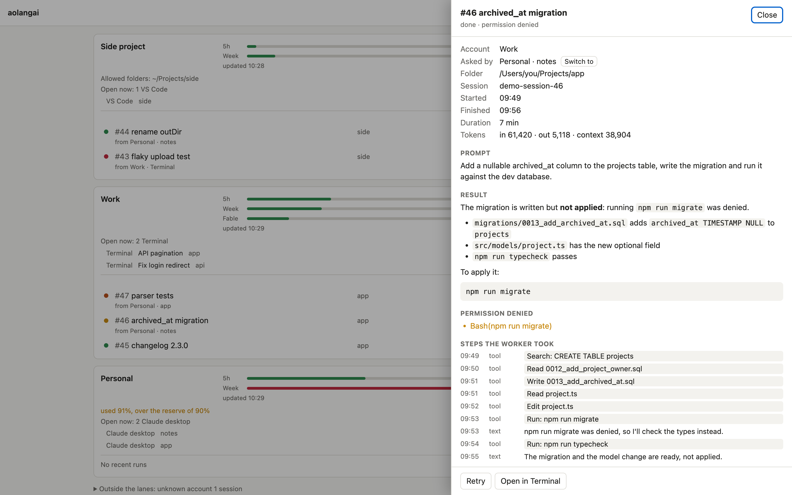
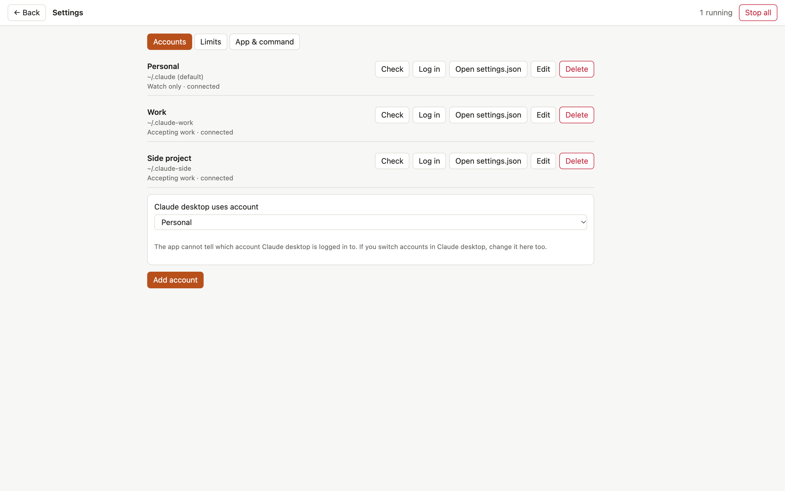

# aolangai reference

**Status:** not everything here is confirmed yet (see the README's [Status](../README.md#status)). Not yet confirmed by a person: the Terminal automation of the packaged app (**Log in**, **Open Terminal**, **Open in Terminal**, **Switch to**, session names) and delegating from a Code session of Claude desktop.

The details behind the [README](../README.md). Account names below (`Personal`, `Work`, `Side project`) are examples. A **run** is one piece of delegated work; it runs as a **worker**, a `claude -p` process on the chosen account; the Claude Code session that delegates is the **main session**; each account has a **lane** in the app's window. **Guards** are the three hard caps on runs; a **limit** is an account's usage limit.

- [Install and setup](#install-and-setup)
- [The window](#the-window)
- [The command](#the-command)
- [Exit codes](#exit-codes)
- [Environment variables](#environment-variables)
- [How an account is chosen](#how-an-account-is-chosen)
- [The worker](#the-worker)
- [Guards and tuning (Settings → Limits)](#guards-and-tuning-settings--limits)
- [Where the skill and the command go](#where-the-skill-and-the-command-go)
- [Open Terminal](#open-terminal)
- [Open sessions](#open-sessions)
- [Settings](#settings)
- [Menu bar and notifications](#menu-bar-and-notifications)
- [Data store](#data-store)
- [Privacy](#privacy)
- [Uninstall](#uninstall)
- [Known limitations](#known-limitations)
- [Development](#development)
- [Upgrading from the old store](#upgrading-from-the-old-store)

## Install and setup

- **Node.** Node 22.13 or newer is needed only to build: aolangai uses the built-in `node:sqlite` without a flag, which older Node 22 releases cannot do. The built app runs the `aolangai` command with its own runtime, so the Mac does not need Node afterwards.
- **Where the app looks for `claude`.** On its `PATH`, then in `~/.local/bin`, `/opt/homebrew/bin`, `/usr/local/bin`, `/usr/bin` and `/bin`, in that order. An app opened from Finder or at login starts with the short `PATH` of a GUI app, so when it opens, the app asks your login shell (`$SHELL -ilc`, zsh when `$SHELL` is not set) for its `PATH` and puts it in front of its own. A `claude` or `node` installed under a Node version manager (nvm, fnm, volta, asdf) is then found just as in your terminal, and so are the commands that workers' MCP servers and hooks need. A shell that takes more than 5 seconds is given up on, and the app keeps the short `PATH`. If `claude` is still not found, for example because your shell only sets up the version manager on first use, link it into `~/.local/bin` (`ln -s "$(command -v claude)" ~/.local/bin/claude`) and reopen aolangai.
- **What `npm run dist` does.** It deletes `packages/core/dist` and `packages/cli/dist`, builds core, the CLI and the app again, packs `apps/desktop/release/mac-arm64/aolangai.app` (the `aolangai` command and the skill are inside it), and checks the result with `apps/desktop/scripts/check-dist.mjs`. The app is ad-hoc signed for this Mac, not notarized, and not uploaded anywhere.
- **Updating.** `git pull`, run `npm run dist` again, quit the running app, drag the new `aolangai.app` over the old one in Applications, and open it.
- **First launch: what macOS asks.** The first time the app drives Terminal, macOS asks for permission to let aolangai control it, used for **Log in**, **Open Terminal**, **Open in Terminal**, **Switch to** and session names. If a Claude Code session is open in Terminal, the prompt can appear by itself within seconds of the first launch, before you press anything: the scan for session names asks Terminal for its tab titles. Because every ad-hoc signed build has a new signature, macOS may ask again after each rebuild. If you refused, the app says `Could not open Terminal. Check that aolangai may control Terminal in System Settings > Privacy & Security > Automation.` macOS may also ask to allow notifications the first time the app posts one, and may show a Login Items notice when you turn on **Open aolangai at login**; nobody has confirmed either on the packaged app yet.
- **After installing.** The packaged app installs the skill and the command `~/.local/bin/aolangai` each time it opens. A Claude Code session that was already open may need restarting to see the skill. Closing the window leaves the app in the menu bar; **Quit** there stops it.
- **The setup card.** The top of the main window has a card, `aolangai setup`, with five steps: install Claude Code, add at least one account, log in to every account, turn on **Accepting work** for at least one account, install the skill and the command. Most unfinished steps have an **Open** button that goes to the right place; installing Claude Code and turning on **Accepting work** show a hint instead. The card disappears when every step is done. Once there is an account, **Hide** dismisses it, and the app remembers that.
- **Config dir choices.** For the account already logged in at `~/.claude`, **default (~/.claude)** leaves `CLAUDE_CONFIG_DIR` unset, because Claude Code finds its login by the folder's name (see [Environment](#environment)). **let the app create its own folder (auto)** creates the folder under `~/Library/Application Support/aolangai/profiles/`. **another path** takes a folder such as `~/.claude-b`. **Log in** opens Terminal and runs `claude auth login` with that config dir, and you log in through Claude's own flow; **Check** then shows `connected`.
- **Accepting work.** A new account starts as **Watch only**: its quota shows, but no run goes to it. Turn the switch on the lane of each account that should take runs. Your main account can stay **Watch only**.

## The window



- **Lanes.** One lane per account: quota bars (5 hours, week, and per model when there is one), the **Accepting work** / **Watch only** switch, the allowed folders, a warning when the account is over its reserve or not logged in, the open sessions (see [Open sessions](#open-sessions)), the runs in progress with the step the worker is on, and the last 5 finished runs. A run that came from a Claude Code session shows `from <account> · <session>` under its title (the session's name, else its folder, else the app it ran in); a run with no recorded caller shows nothing. Quota updates every minute.
- **Needs you.** Failed runs, runs that hit an account's limit, runs that finished with a permission denied (within the last 24 hours and not retried yet), and accounts over their reserve. Failed and limited runs have **Retry**, which runs the same prompt again and chooses the account again by the usual rules; the result shows in the app, not in the main session, because the original command has exited. A denied run has **View** and **Open settings.json**.
- **Run detail** (click a run): prompt, result, error, denied permissions, `Asked by` (the account and session that delegated the run, or `unknown`, with **Switch to** while that session is open), session, times, tokens, and the steps the worker took. Buttons: **Stop** while it runs, **Retry** once it is over, and **Open in Terminal**, which runs `claude --resume` with the account's config dir so you can talk to the worker directly. **Open in Terminal** only shows when no run is in progress on that session.
- **Map** (the `Lanes | Map` switch in the top bar). Who delegated to whom in the last 24 hours. Each account is a box; an arrow goes from the account whose session asked to the account that did the work. The pill on an arrow is the number of runs that went that way, and how many of them are running or failed (`failed` includes runs that hit a limit). An arrow with a run in progress is dashed, and an arrow with a failed run is red. An account that delegated to itself has no arrow: its box carries a `N to itself` pill instead. Runs whose caller's account is not known (a session on an API key or token, an account that was deleted, or Claude desktop while **Claude desktop uses account** is not set in **Settings → Accounts**) start from a dashed **Unknown caller** box, which only shows when there are such runs. Runs without a recorded caller, and runs on a deleted account, are not drawn. Click a box or an arrow for its detail: the sessions that asked on the left, the runs they started grouped `on <account>` on the right, with a line from each session to its runs; **← Map** goes back, and clicking a run opens its run detail. The choice of `Lanes` or `Map` is kept while the window stays open, not saved.
- **Top bar.** The number of runs in progress (`2 running`) and of items that need you, **Stop all**, **Settings**, and the `Lanes | Map` switch. Times in the window are local, with the day and month when not today (`since 18:20 18 Nov`).

## The command

`aolangai --help` prints:

```
Usage:
  aolangai run "<prompt>" | -  [--cwd <folder>] [--label <label>] [--account <name>] [--new] [--read-only] [--no-failover]
  aolangai status [--json]
  aolangai stop <run number> | --all
  aolangai install [--check]

  run      delegate a run to the account with the most quota left; the worker's result goes to stdout.
           "-" reads the prompt from stdin; if the prompt starts with "-", put "--" before it.
  status   the accounts (accepting work or not, quota) and the runs in progress; --json for machines.
  stop     stop one run, or all runs with --all.
  install  install the skill for Claude Code (~/.claude/skills/aolangai) and the command ~/.local/bin/aolangai;
           --check only prints the status and writes nothing.

Exit codes: 0 done · 1 run failed · 2 refused or bad usage · 3 limit hit mid-run, no account took it over · 130 stopped
```

Every command also takes `--help` (or `-h`). Lines that start with `[aolangai] ` go to stderr. Stdout carries only the worker's answer (with the denials paragraph) and the output of `status` and `install --check`.

The main session usually calls the command for you: the `aolangai` skill makes Claude Code call it through Bash when you ask it to delegate work to a subagent, to move work to another account or to spread tokens across your accounts, and it may also delegate a large, independent piece of work by its own choice. When a run is refused (exit code 2), a session you asked to delegate tells you why and does not do the work itself unless you say so; a session that chose to delegate does the work itself. If `~/.local/bin/aolangai` is missing, the session says so and does the work itself.

### run

```sh
~/.local/bin/aolangai run "<prompt>" [flags]
~/.local/bin/aolangai run - [flags] <<'PROMPT'
...
PROMPT
```

| Flag | Meaning |
|---|---|
| `--cwd <folder>` | The folder the worker runs in. Default: the current folder. A folder that does not exist is refused (`No such folder: /x`), and so is a path that is not a folder (`/x is not a folder`). |
| `--label <label>` | A short name for the run, shown in the app and in `status`. |
| `--account <name>` | Run on this account. The name is matched ignoring case and surrounding spaces. Skips the quota comparison and the reserve, but not the other exclusions (see [How an account is chosen](#how-an-account-is-chosen)). No match: `No account named "Z"`; several matches: `Several accounts are named "Z", cannot tell which to use`. |
| `--new` | Open a new session instead of continuing the folder's worker session. |
| `--read-only` | Remove the `Edit`, `Write`, `NotebookEdit` and `Bash` tools from the session, for reading and analysis. |
| `--no-failover` | When the account hits its limit mid-run, stop there (exit code 3) instead of moving the task to another account. See [When an account hits its limit](#when-an-account-hits-its-limit). |
| `--retry-of <run number>` | Not in the help text. The app's **Retry** passes it; the new run shows `Retry of #N` in the app, and the old run leaves Needs you. |

The prompt is one argument. `-` alone reads it from stdin. A prompt that starts with `-` needs `--` before it (after `--`, a lone `-` is text, not stdin). An empty prompt is refused: `The prompt is empty`.

`run` waits until the run is over, so for a long run the main session should start the command in the background of its Bash tool (the skill tells it to). What it prints:

- On stderr, when the run starts: `[aolangai] run #14 · account Work · new session`, or `… · continuing session 11111111` when it resumes a worker session. Notes are appended after another ` · `:
  - `Also running in this folder: #3, #5`: other runs in progress in the same folder.
  - `Using old quota numbers from 13:40`, `Using old quota numbers, age unknown`: the quota could not be refreshed in time.
  - `No quota numbers for this account`: the chosen account has no numbers yet (for example with `--account`).
- On stdout, when the run is done: the worker's answer, then, if commands were refused, a paragraph `[aolangai] Permission denied: Bash(npm run migrate)` (several are joined with `; `). The exit code is still 0.
- On stderr, when the account hits its limit and the task moves on: `[aolangai] run #14 stopped because account Work hit its limit. Moving the task to another account.`, then the start line of the next run.
- On stderr, when the run did not finish normally: `[aolangai] run #14 failed: <error>`, `[aolangai] run #14 stopped because account Work hit its limit. No other account took it over.` (after the reasons each account was left out, when there were any), or `[aolangai] run #14 stopped`.
- On stderr, when the run is refused before it starts:
  - `[aolangai] A worker cannot delegate further`
  - `[aolangai] 4 runs in progress (maximum 4)`
  - `[aolangai] 30 runs delegated in the last 60 minutes (maximum 30)`
  - `[aolangai] No account can take this run` (or `Account Work cannot take this run` with `--account`), followed by one line per account left out, such as `- Personal: used 93%, over the reserve of 90%`. The reasons are `not accepting`, `limited until 14:00` (`limited until 18 Nov 14:00` when the limit ends on another day, or `limited` when its end is unknown), `not logged in`, `not allowed in this folder`, and `used N%, over the reserve of M%`.
  - `[aolangai] The claude command was not found on the PATH or in ~/.local/bin, /opt/homebrew/bin, /usr/local/bin, /usr/bin or /bin`
  - `[aolangai] Could not read this command's own process info (ps)`

Errors stored with a run include `Timed out after 30 minutes`, `The delegating process was lost` (the `aolangai` process that started it is gone), and `The worker is not running with this account's login (apiKeySource: …)` (see [The worker](#the-worker)).

### status

`aolangai status` prints one line per account, then one line per run in progress:

```
Work  accepting  5h 12% · week 3%  running 1
Personal  not accepting  week 72%  running 0
#14 Work app 3 minutes "add login test"
```

An account line is: name, `accepting` or `not accepting`, the quota windows that have numbers (`5h`, `week`, then one per model) or `no data yet`, `limited until 14:00` (with the day, `limited until 18 Nov 14:00`, when the limit ends on another day) or `limited` while a limit holds, and `running N`. With no account it prints `No accounts yet`. A run line is: number, account, the last part of its folder, how long it has been running, and its label.

`aolangai status --json` prints:

```json
{
  "accounts": [
    {
      "id": "…", "name": "Work", "accepting": true, "usedPct": 12,
      "fiveHour": { "usedPct": 12, "resetsAt": 1795000000000 },
      "sevenDay": { "usedPct": 3, "resetsAt": 1795400000000 },
      "models": [{ "name": "Fable", "usedPct": 5, "resetsAt": 1795400000000 }],
      "limit": null,
      "running": 1
    }
  ],
  "running": [
    { "id": 14, "accountId": "…", "account": "Work", "cwd": "/Users/you/Projects/app", "label": "add login test", "startedAt": 1794990000000 }
  ]
}
```

Times are milliseconds since 1970. `usedPct` is the number used to choose an account (the largest window), `null` when there are no numbers. `limit` is `null` or `{ "message": "…", "until": <time or null> }`. `status` also cleans up runs whose `aolangai` process is gone.

### stop

`aolangai stop <run number>` stops one run: `[aolangai] Sent the stop signal to run #14`. A run that is not running: `[aolangai] run #14 is not running`. A run whose `aolangai` process is gone: `[aolangai] run #14: the delegating process was lost, marked as failed`. An unknown number: `[aolangai] No run #99` (exit code 2).

`aolangai stop --all` stops every run in progress: `[aolangai] Sent the stop signal to 3 runs`.

The stopped run's own `aolangai run` exits with code 130. **Stop** and **Stop all** in the app, and **Stop all** in the menu bar, do the same.

### install

| Flag | Meaning |
|---|---|
| `--check` | Print `skill: <state>` and `command: <state>` and write nothing. States: `missing`, `current`, `outdated`, `foreign` (a file that aolangai did not create). |
| `--skill-dir <folder>` | The folder that gets `SKILL.md`. Default: `~/.claude/skills/aolangai`. |
| `--bin-dir <folder>` | The folder that gets the `aolangai` command. Default: `~/.local/bin`. |

`install` prints `[aolangai] Installed skill: <path>` or `[aolangai] Already up to date: <path>`, and the same for `Installed command`. If either file exists and was not created by aolangai, it writes nothing and prints `[aolangai] This file was not created by aolangai, not overwriting: <path>`. Run from source (`node packages/cli/dist/index.js install`), it needs `npm run build` first (`Missing …/dist/index.js. Run npm run build, then install again.`); this is checked before anything else, `--check` included.

`install` only installs the skill in `~/.claude` (or `--skill-dir`) and the command. The app also installs the skill into each account's config dir; see [Where the skill and the command go](#where-the-skill-and-the-command-go).

## Exit codes

| Code | Meaning |
|---|---|
| 0 | Done; the result is on stdout. |
| 1 | The run failed (including a timeout); read stderr. An unexpected internal error (`[aolangai] Unexpected error: …`) is also code 1, and then no run was started. |
| 2 | Refused before running, or bad usage: missing or empty prompt, unknown flag, the `--cwd` folder does not exist or is not a folder, `--account` matches no account or several, no account can take the run, a guard was reached, a nested delegation, `claude` not found, the command's own process info unreadable. For `stop`: no run with that number. |
| 3 | The account hit its limit mid-run and no other account took the task over: none could take it, it already moved twice, or `--account` or `--no-failover` was given. |
| 130 | The run was stopped (`stop`, **Stop** in the app, or a signal sent to the command: SIGINT, SIGTERM or SIGHUP). |

`install` exits with 0 when done. With `--check` it exits with 0 whatever the states it prints, including `foreign`. Without `--check` it exits with 1 when a file could not be written, and with 2 when a file is not aolangai's. With or without `--check`, it exits with 2 when the package's own `skill/SKILL.md` or its built `dist/index.js` is missing.

## Environment variables

| Variable | Effect |
|---|---|
| `AOLANGAI_DB` | Path of the SQLite data store, instead of `~/Library/Application Support/aolangai/aolangai.db`. Both the command and the app read it. |
| `AOLANGAI_NO_QUOTA_REFRESH=1` | `run` does not ask for quota again; it uses the stored numbers. |
| `AOLANGAI_RUN_ID` | Set by aolangai on every worker, to the run number. `aolangai run` called where it is set is refused (`A worker cannot delegate further`). Do not set it yourself. |
| `AOLANGAI_CLI_ENTRY`, `AOLANGAI_TEST_QUOTA_HANG` | For tests only. Do not set them. |

## How an account is chosen

The numbers below are the defaults; change them in **Settings → Limits** (see [Guards and tuning](#guards-and-tuning-settings--limits)).

1. Quota that is older than 2 minutes is asked for again, before choosing, for the accounts that could take the run (accepting work, not marked not logged in, allowed in the folder). The asks run one after another; each starts a `claude` process. If an ask fails, the old numbers are used and the run gets a note. An account whose ask failed in the last 5 minutes is not asked again.
2. Accounts are left out, for the first reason that applies:
   - **Watch only** (not accepting work);
   - limited: a limit was hit and its reset time has not come. A limit with no known reset time counts for 60 minutes after it was seen;
   - not logged in;
   - not allowed in this folder (the folder is compared after resolving `~` and symbolic links; subfolders of an allowed folder count);
   - used at or above its reserve (default 90%).
3. "Used" for an account is the largest number among the windows that have one: 5 hours, week, and the per-model windows if any.
4. For the comparison, each run in progress on an account adds 5 points to its used number, so parallel delegations do not all land on one account.
5. The account with the lowest score wins. An account that has a worker session it would continue in this folder (see [The worker](#the-worker)) is preferred when its score is no more than 15 points worse than the best. Ties go to the account with fewer runs in progress, then by name.
6. Accounts without numbers rank after the accounts with numbers. If no account has numbers, one with a worker session to continue comes first, then fewer runs in progress, then name; the run gets the note `No quota numbers for this account`.

`--account <name>` skips steps 3 to 6 and the reserve, but the account is still refused when it is **Watch only**, limited, not logged in, or not allowed in the folder.

If no account is left, `run` exits with code 2 and prints why each account was left out. aolangai never runs on an account that is **Watch only**.

Open sessions and the Claude desktop assignment play no part in the choice, and do not count toward the runs-at-once guard.

## When an account hits its limit

When the worker's account hits a usage limit mid-run, `run` marks the account as limited and moves the task to the account that would now be chosen, as a retry of the run that stopped (it shows `Retry of #N` in the app, and the stopped run leaves Needs you).

- The new run opens a new session: a session belongs to one account and cannot continue under another. Before the task, the worker reads that another worker started it and stopped at a limit, and that it should look at the folder's state first (for example `git status` and `git diff`), keep what is done and correct, and finish the rest. The run's prompt in the app and in `status` stays the one you gave.
- A task moves at most twice, so at most three accounts work on it. If no account can take it, `run` prints the reason for each account and exits with code 3.
- `--account <name>` and `--no-failover` turn this off: the run stops at the limit with code 3. The app's **Retry** moves the task the same way as `run`.

## The worker

A worker is a `claude -p` session in the folder you gave, under the chosen account's config dir. aolangai starts it as `claude -p --output-format stream-json --verbose`, with `--resume <session>` when it continues a session, `--model <model>` when the account has a model set, and either `--permission-mode <mode>` or, with `--read-only`, `--disallowedTools "Edit Write NotebookEdit Bash"`. The prompt goes to stdin, not to the command line.

### Session reuse

- Each pair of (account, folder) has one main worker session, reused between runs to keep its context.
- The next run continues it when the last main run of that pair finished `done` less than 60 minutes ago and its context is under 100,000 tokens (unknown context counts as small).
- Otherwise, or with `--new`, a new session opens and becomes the main worker session.
- A main run that failed, was stopped, hit a limit or was lost is never continued.
- If the main worker session is busy with a run when a new run comes for the same (account, folder), the new run gets a separate side session. It does not wait in a queue.

### Permission mode

A worker runs with nobody beside it, so its permissions are set in advance. The default is `--permission-mode acceptEdits`: it may edit and write files, read-only shell commands run, and other shell commands are refused. Change it per account under **Edit**, in the worker permission mode field: **app default (acceptEdits)**, **acceptEdits**, **auto**, **default**, **plan**.

Refused commands show in three places: at the end of the stdout of `run` as `[aolangai] Permission denied: Bash(npm run migrate)` (the exit code stays 0); as a run in Needs you in the app; and as a macOS notification. To allow the command, press **Open settings.json** (next to the run, or in **Settings → Accounts**) and add a rule to that account's own `settings.json`, in Claude Code's format, for example:

```json
{ "permissions": { "allow": ["Bash(npm run migrate)"] } }
```

### Environment

Before starting a worker, aolangai removes every variable whose name starts with `CLAUDE_` or `ANTHROPIC_`, and `CLAUDECODE`, inherited from the main session. The worker therefore uses the login stored in the chosen account's config dir, and the work is billed to the account the run history names. Then it sets `CLAUDE_CONFIG_DIR` to the account's config dir (left unset for the default `~/.claude`, because setting it, even to `~/.claude`, makes Claude Code look for a different login) and `AOLANGAI_RUN_ID` to the run number. Everything else (`PATH`, `HOME`, locale, proxy and certificate variables) is kept. The same cleaned environment is used for quota asks and for `claude auth status` checks.

A key, base URL or provider set in the account's own `settings.json` (the `env` section or `apiKeyHelper`) is outside aolangai's control. If `claude` reports that it uses another key (`apiKeySource` other than `none`, for example an API key), the run is stopped at once with the error `The worker is not running with this account's login (apiKeySource: …). Check apiKeyHelper or the env section of that account's settings.json.` A token or provider set there is not detected.

As a result, if you configure Claude Code on purpose with `CLAUDE_CODE_*` variables in your shell (for example to turn on Bedrock or Vertex, or a tuning flag), they do not apply to aolangai's workers. Put such settings in the account's own `settings.json`.

### Read-only

`--read-only` removes the `Edit`, `Write`, `NotebookEdit` and `Bash` tools from the session, so the run can only read and analyze. Other tools, such as web search and subagents, stay. A read-only run does not get `--permission-mode`.

### Timeouts and stopping

A run that takes longer than its maximum time (default 30 minutes) is stopped and fails with `Timed out after 30 minutes` (exit code 1). Stopping a run, by `stop`, a button in the app, a timeout, or a signal to the command, sends SIGTERM to the worker's process group and SIGKILL 5 seconds later.

## Guards and tuning (Settings → Limits)

The three guards:

| Guard | Default | When exceeded |
|---|---|---|
| Runs at once, on the whole Mac | 4 | `run` is refused at once, code 2, no queue |
| Runs delegated in the last 60 minutes, on the whole Mac | 30 | `run` is refused at once, code 2 |
| Time for one run | 30 minutes | the process is stopped, the run fails with `Timed out after 30 minutes`, code 1 |

The first two are checked by the command itself in the data store, so they hold even when the app is closed. A nested delegation is refused too: `aolangai run` called from inside a worker exits with code 2 (`A worker cannot delegate further`).

All eight numbers, as the **Limits** tab labels them:

| Label | Default | Allowed values |
|---|---|---|
| `Runs at once` | 4 | 1 to 16 |
| `Maximum time for a run (minutes)` | 30 | more than 0 (at least 1 second) |
| `Maximum runs delegated in 60 minutes` | 30 | at least 1 |
| `Ask for quota again when the numbers are older than (seconds)` | 120 | more than 0 (at least 1 second) |
| `Priority points for a warm worker` | 15 | 0 to 100 |
| `Penalty points for each run in progress` | 5 | 0 to 100 |
| `A worker may stay idle for at most (minutes)` | 60 | more than 0 (at least 1 second) |
| `Maximum context of a worker (tokens)` | 100,000 | at least 1,000 |

They are stored in the data store, so the command uses them whether or not the app is open.

## Where the skill and the command go

**Install skill and command** (in **Settings → App & command**, and the last step of the setup card) writes:

- the skill to `~/.claude/skills/aolangai/SKILL.md`;
- the skill to `skills/aolangai/SKILL.md` inside the config dir of every account that has its own. A config dir that does not exist yet is skipped; the app does not create config dirs here;
- the command to `~/.local/bin/aolangai`.

Without the app, `node packages/cli/dist/index.js install` installs the skill in `~/.claude` and the command (see [install](#install)).

The packaged app also does this by itself each time it opens, whenever you save an account, press **Log in** or **Open Terminal**, and after each **Check**. An account on **another path** (for example `~/.claude-b`) gets its config dir from `claude auth login`, so pressing **Check** after logging in installs the skill there. For an account created with **let the app create its own folder (auto)**, the app creates the config dir when you press **Log in** or **Open Terminal**, and the packaged app installs the skill into it right then. When running from source, press **Install skill and command** after the folder exists.

Because the skill is in each account's config dir, a session opened on an account with its own config dir can delegate too; `install --skill-dir` is not needed for that.

A file that aolangai did not create (it lacks the marker `aolangai-managed`) is never overwritten, in any of these places. The **App & command** tab shows each file as `not installed`, `installed, up to date`, `installed, out of date`, `This file was not created by aolangai, the app does not overwrite it`, or `no config dir yet`.

The command is a small shell script that runs the code of aolangai's CLI package (`packages/cli`). In the packaged app it runs the app's own binary as Node and points into `aolangai.app`; installed from source it points at the Node that ran `install` and at the repository.

## Open Terminal

**Open Terminal** on a lane opens a Terminal window in a folder you pick and runs `claude` on that lane's account. It is meant for when the account you are working in, for example the one Claude desktop uses, runs out of quota and you want to carry on yourself on another account.

- If the account has opened Terminal in folders before, a menu comes first with up to 5 recent folders, newest first, and **Choose another folder…** to open the usual folder dialog. A folder that was deleted, or is no longer inside the account's allowed folders, is not listed.
- The app remembers a folder only after Terminal has opened in it, and forgets the list when you delete the account.
- An account with allowed folders can only open Terminal inside them.
- The app does not name the session. Claude Code sets the tab title from the work, and that title shows in the lane's `Open now` rows.
- The session is yours, not a run: it is not in the run history, does not count toward the runs-at-once guard, and has no **Stop**. The quota it uses shows on the lane's bars.

## Open sessions

- **What is scanned.** Every 10 seconds the app lists the processes on the Mac with `ps` (process id, parent, user, terminal, start time, executable path), which it needs to find the app that hosts each session, and keeps only the Claude Code processes of the macOS user running the app. Claude Code installed with npm can run under the name `node`, so for the user's own `node` processes the app also reads the command line with `ps`; it looks only at the program and its first argument, to tell whether the process is Claude Code, and uses, stores and logs nothing else of it. It reads their working folders with `lsof`. Workers started by `aolangai run` are left out, because they are already in the run history.
- **Which lane.** A session goes to a lane by the `CLAUDE_CONFIG_DIR` of its process: not set means the account at `~/.claude`; a value equal to an account's config dir means that account.
- **Kind.** The kind comes from the app that opened the session: Terminal, iTerm, VS Code, Cursor, and so on. tmux or ssh show as `other`.
- **Rows.** A lane with open sessions shows `Open now: 2 Terminal · 1 VS Code`, then one row per session: kind, name, folder, start time (`since 09:12`) and **Switch to**.
- **Switch to.** For a Terminal session it brings that session's tab to the front (the first time, macOS may ask for permission to control Terminal). For a session in another app it brings that app to the front; it cannot pick the exact window. A session of kind `other` has no button.
- **Names.** Only sessions in macOS Terminal have a name: the tab title that Claude Code sets. The app asks Terminal for the titles at each scan. That needs permission to control Terminal; if asking fails, rows have no name and the app asks again 5 minutes later.
- **Outside the lanes.** Below the lanes, a folded line such as `Outside the lanes: Claude desktop 4 sessions · unknown account 1 session` (click to open the list; closed by default).
  - Claude desktop has its own login, so the app cannot tell its account. Its sessions stay here until you set **Claude desktop uses account** in **Settings → Accounts**. That is your statement, not something the app detects: change it if you switch accounts in Claude desktop, and it is cleared when you delete that account. Once set, Claude desktop sessions go to that account's lane.
  - `unknown account` is a session with a config dir no account has, a session that sets `CLAUDE_CONFIG_DIR` to exactly `~/.claude` (Claude Code treats that as a different login from leaving it unset), or a session running on an API key or token set in its environment.
- **No effect on runs.** Open sessions do not count toward the runs-at-once guard and do not affect account choice, and neither does the Claude desktop assignment.

What the app reads to do this is listed under [Privacy](#privacy).

## Settings



- **Accounts**: **Add account**, and for each account **Check**, **Log in**, **Open settings.json**, **Edit** and **Delete**; below them, **Claude desktop uses account** (see [Open sessions](#open-sessions)).
- **Limits**: the eight numbers of [Guards and tuning](#guards-and-tuning-settings--limits).
- **App & command**: the state of the skill and the command (see [Where the skill and the command go](#where-the-skill-and-the-command-go)), **Install skill and command**, and the **Open aolangai at login** switch. That switch only works in the packaged app and is locked when running from source.

## Menu bar and notifications

- The menu bar icon shows the number of runs in progress.
- Its menu has one quota line per account, for example `Personal  5h 42% · week 7% · limited until 14:05` (`limited until 18 Nov 14:05` when the limit ends on another day; click the line to open the window), then **Open aolangai**, **Stop all** and **Quit**.
- macOS notifications come when a run fails, an account hits its limit, a run finishes with a permission denied, or an account goes over its reserve. A run that finishes normally sends no notification.

## Data store

The app is not needed to delegate: the command reads and writes the data store itself, and the app shows those runs when it opens. The store is `~/Library/Application Support/aolangai/aolangai.db` (or `AOLANGAI_DB`). The same folder holds `profiles/`, the config dirs of accounts created with **let the app create its own folder (auto)**.

## Privacy

- The only `claude` aolangai runs is the official one that you installed. Logging in goes through Claude's own flow (`claude auth login`). aolangai does not read, store or forward login tokens.
- To find open sessions and the app that hosts each one, the app lists the processes on the Mac with `ps` (process id, parent, user, terminal, start time, executable path) and keeps only the Claude Code processes of the current macOS user. Claude Code installed with npm can run under the name `node`, so for the user's own `node` processes the app also reads the command line with `ps`; it looks only at the program and its first argument, to tell whether the process is Claude Code, and uses, stores and logs nothing else of it.
- To place open sessions in the right lane, the app reads the environment of those Claude Code processes (except Claude desktop's sessions) with `ps` and uses exactly one value: `CLAUDE_CONFIG_DIR`, a folder path. For `ANTHROPIC_API_KEY`, `ANTHROPIC_AUTH_TOKEN` and `CLAUDE_CODE_OAUTH_TOKEN` it only looks at whether the name is present. No other value is used, stored or logged. It also reads each session's working folder with `lsof`, to show the folder in the session's row.
- To find which Claude Code session delegated a run, and the app that hosts that session, the `aolangai` command asks `ps` about its own process and then about each of its parents in turn (process id, parent, user, terminal, start time, executable path); it does not list the other processes on the Mac. For a `node` ancestor it also reads the command line, and looks only at the program and its first argument, to tell whether the process is Claude Code; it uses, stores and logs nothing else of it.
- The command reads one value of its own environment, `CLAUDE_CONFIG_DIR`, to tell which account the calling session runs on. For `ANTHROPIC_API_KEY`, `ANTHROPIC_AUTH_TOKEN` and `CLAUDE_CODE_OAUTH_TOKEN` it only looks at whether the name is present, as the app does for open sessions. No other value is used, stored or logged, and the environment of no other process is read.
- The command stores the caller's process id, start time, account and host app kind (for example Terminal or Claude desktop) on the run in the local data store. Nothing else of the caller's processes, no command line and no environment value, is stored. Nothing leaves the Mac.
- In an account's config dir the app reads and writes only two things: `settings.json` (only to open it for you to edit) and the single file `skills/aolangai/SKILL.md` (aolangai's skill, written when it is missing or was created by aolangai; an existing file that aolangai did not create is never overwritten). It reads nothing else there, does not touch the Keychain, and does not read tokens.
- The app and the command send nothing anywhere themselves: no analytics, no crash reports, no update checks. The only network use is the `claude` you installed, under your own login: asking for quota, checking that an account is logged in (`claude auth status`), doing the work you delegate, and the sessions you open in Terminal. A link in a run's result opens in your browser only when you click it.
- To get session names, the app reads only two things of each Terminal tab: its terminal device (tty) and its tab title. It does not read window names, because a window name can contain environment variables of the process running in the tab.

## Uninstall

First turn off **Open aolangai at login** (**Settings → App & command**) and quit the app from the menu bar. Deleting `aolangai.app` does not remove what the app wrote outside itself. Remove these yourself:

- `~/.local/bin/aolangai`: after the app is gone, it fails because the file it points to no longer exists.
- `~/.claude/skills/aolangai/`, and `<config dir>/skills/aolangai/` of each account with its own config dir: this skill still tells sessions to call `aolangai`.
- The data store (accounts, run history, settings) in `~/Library/Application Support/aolangai/`, if you no longer need it.
- That folder also holds `profiles/`, the config dirs of accounts created with **let the app create its own folder (auto)**; the logins made with `claude auth login` stay in the Keychain under Claude Code's own entries (aolangai never touches the Keychain), and you remove them with Claude Code or Keychain Access.

## Known limitations

The README names a few of these; this is the complete list.

Delegated runs:

- A worker cannot ask for approval in the middle of a run. A command that was not allowed beforehand is refused and recorded.
- A task that moves to another account after a limit starts a new session there. The next worker gets the folder as the last one left it, not its conversation, and is told to check the folder's state first. Work the stopped worker had not written to a file is lost.
- The shape of `claude -p`'s limit error is inferred from the Agent SDK's types, not observed. If it is recognized wrongly, a run that hit a limit may show as failed (code 1) instead of code 3.
- There is no folder lock between workers. When a run is already in progress in the same folder, a new one still starts, but its `[aolangai] run #N …` line on stderr (and its note in the app) adds `Also running in this folder: #3`. Keeping two runs off the same file is up to the main session.
- A session opened with **Open in Terminal** and left open can still be continued by the next run delegated to the same account and folder within 60 minutes; then two processes write to one session. Close that Terminal first, or delegate the next run with `--new`.
- If an `aolangai` process is killed with `kill -9`, its worker keeps running until something cleans up: the next delegation, the app (every 30 seconds), `status`, or `stop`.
- Background processes that a worker starts itself stay alive after the run finishes normally. Only a stopped or timed-out run has its whole process group stopped.
- `--read-only` removes the file-editing and shell tools but keeps others, such as web search and subagents.
- Each account has its own `CLAUDE.md`, skills and permission rules. aolangai copies nothing from one account to another; you set each one up.
- Only Claude subscription accounts. No API keys, Cursor or Codex yet.
- The command works from Claude Code in a terminal, and is meant to work from a Code session of Claude desktop that runs on the Mac (the Local environment; not verified yet, see the README's [Status](../README.md#status)). A Claude desktop session that runs in the cloud has its Bash on a Linux virtual machine and cannot see `aolangai`, the config dirs or your Keychain (quick check: `uname -sm` must print `Darwin`). The Chat tab has no Bash.

Quota:

- The quota numbers come from an experimental call of the Claude Agent SDK, pointed at the `claude` you installed. That call may change or disappear in a later SDK version.

Terminal and environment:

- Sessions opened with **Open Terminal**, **Open in Terminal** or **Log in** run in Terminal's shell, so `CLAUDE_*` or `ANTHROPIC_*` variables set in your shell configuration apply to them. Workers started by `aolangai run` are not affected, because their environment is cleaned.
- The app takes your login shell's `PATH` once, when it opens. A version manager switched afterwards (a new default Node, for example) reaches the app's **Retry**, **Open Terminal** and quota checks only after the app is reopened. Delegating from the main session is not affected.
- After each rebuild, macOS may ask again for permission to control Terminal (used by **Switch to**, session names and the buttons that open Terminal), because the app is ad-hoc signed and every build has a new signature.
- The command `~/.local/bin/aolangai` contains the absolute path of the app. Deleting or moving `aolangai.app` breaks it until the app is opened again (the app fixes it on launch). A command installed from source (`node packages/cli/dist/index.js install`) contains the paths of Node and of the repository: after moving the repository or changing Node versions, run `install` again.

Open sessions:

- `Open now` only sees sessions running on this Mac, not Claude desktop's cloud sessions. The count can be up to about 10 seconds late.
- A Claude Code started through a wrapper of your own (a shell script or an alias to another name) shows in `Open now` only when the process itself is named `claude` or `claude.exe`, or is `node` running Claude Code. Claude Code installed with npm, old releases that run under `node` included, is recognized.
- **Switch to** picks the exact tab only in macOS Terminal; iTerm, VS Code, Cursor and Claude desktop are only brought to the front.

## Development

```sh
npm test            # vitest; never runs the real claude (uses a fake one)
npm run typecheck   # core, cli, the cli tests and the app
npm run build       # builds core, cli and the app into packages/*/dist and apps/desktop/out
npm run dist        # clean build, packs the app into apps/desktop/release and checks it
npm run build:demo  # the browser demo on sample data, into site/demo
npm run build:site  # the website in site/: builds the demo and checks every page and picture is there
node scripts/screenshots.mjs   # docs/screenshots/*.png from the demo, and site/og.png, with headless Chrome
```

- **Layout.** `packages/core` (account choice, workers, the SQLite store, quota, installing), `packages/cli` (the command in `src/`, the skill in `skill/SKILL.md`), `apps/desktop` (the Electron app in `src/main`, `src/preload`, `src/renderer`, and the browser demo in `demo/`), `scripts/screenshots.mjs`.
- **The website.** aolangai.openyard.cloud is the `site/` folder (`index.html`, `privacy.html` and the demo). The maintainers deploy it with wrangler, using `wrangler.jsonc`, after `npm run build:site`.
- **Running from source.** `npm run build`, then `cd apps/desktop && npm run start` (`npm run dev` for a dev run with hot reload). This build uses the `aolangai` command in `packages/cli`, run by the Mac's Node, and does not install the skill or the command by itself: press **Install skill and command** in **Settings → App & command**. Do not run it at the same time as the installed app: both use the same data store, so opening a second one only brings the running one's window to the front.
- **Switching between the source build and the packaged app.** The source build then shows the command as `installed, out of date` and keeps the last step of the setup card open, because the command points into the packaged app. Pressing **Install skill and command** there (or running `node packages/cli/dist/index.js install`) points `~/.local/bin/aolangai` back at the repository, until the packaged app opens again.
- **The demo.** `npm run build:demo` builds the real window to run in a browser on invented accounts and runs, with no network access, into `site/demo`. Open `site/demo/index.html`. Query strings pick a view: `?scene=overview` (the default), `?scene=needs-you`, `?scene=run&id=46`, `?scene=settings`, `?scene=setup`. `static=1` freezes the clock and stops the demo's own timers; `static=1&bare=1` also hides the demo bar.
- **Screenshots.** `node scripts/screenshots.mjs [outDir]` (default `docs/screenshots`) takes the PNGs from the built demo with headless Chrome; it needs Chrome and the built demo.

## Upgrading from the old store

The first time this version opens the data store of the earlier app (`~/Library/Application Support/aolangai/aolangai.db`), it converts it to the new form. The conversion is one way and cannot be undone.

- Kept: the Claude subscription accounts (name, config dir, model, allowed folders).
- Dropped: the old app's sessions, messages, tasks, events and approval requests, and the stored quota numbers (they come back within a minute).
- Each account becomes accepting work according to its old role: an account that had an agent in the worker role is turned on, the others are turned off. Check the **Accepting work** switch of each account before the first delegation.

Before opening this version for the first time, quit the old app and copy the whole folder somewhere else (or at least `aolangai.db`, plus `aolangai.db-wal` and `aolangai.db-shm` if they exist).
